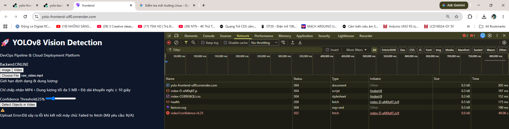
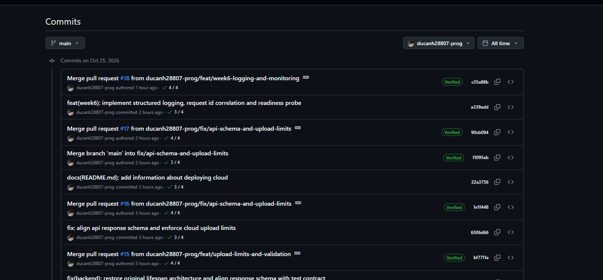
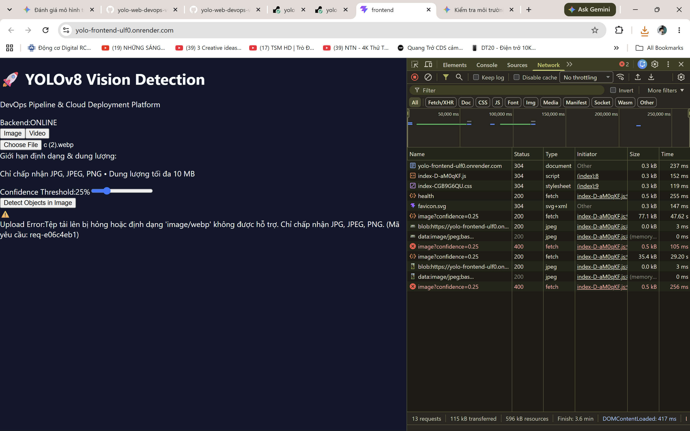
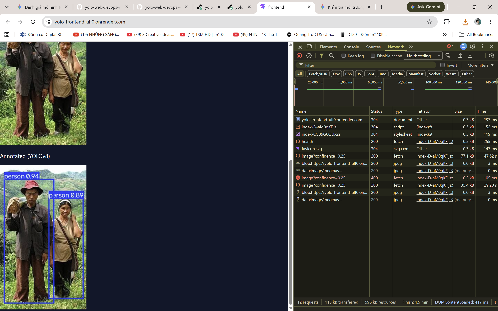

# Báo Cáo Bài Tập Xử Lý Sự Cố (Incident Exercise Report)

- **Mã sự cố (Incident ID):** INC-20261025-CASCADING-CHAIN
- **Thời gian xử lý:** 25/10/2026 – 27/10/2026
- **Hệ thống ảnh hưởng:** YOLO Web Platform (Backend API FastAPI & Frontend React trên Render)
- **Mức độ ảnh hưởng:** High – Sự cố diễn tiến theo chuỗi 4 giai đoạn phản ứng dây chuyền (Cascading Regression): Sau khi khắc phục xong lỗi mất mã định danh truy vết (`request_id: N/A`), hệ thống phát sinh lỗi nghẽn Event Loop (`502 Bad Gateway`), tiếp đó bộc lộ nút thắt cổ chai về giải mã ảnh độ phân giải cao trên môi trường giới hạn 512MB RAM, và cuối cùng chạm trần Gateway Timeout khi xử lý video đồng bộ.
- **Kỹ sư phụ trách:** Nguyễn Đức Anh

---

## 1. Dòng Thời Gian & Triệu Chứng Diễn Tiến (Timeline & Symptoms)

Sự cố diễn ra theo chuỗi logic kỹ thuật "Khắc phục lỗi trước làm bộc lộ lỗi sau":

### Giai đoạn 1 (Ngày 25/10/2026): Lỗi đứt gãy luồng thông báo lỗi khi tải tệp sai định dạng
- **Triệu chứng:** Khi người dùng gửi file sai định dạng (ví dụ `.webp`, `.md`), thay vì hiển thị thông báo nghiệp vụ chi tiết của backend, giao diện luôn rơi vào khối lỗi kết nối mặc định:
   > `Upload Error: Đã xảy ra lỗi khi kết nối máy chủ. (Mã yêu cầu: N/A)`
- Mã `request_id` bị rỗng (`N/A`), làm mất hoàn toàn khả năng đối soát log giữa Client và Server.


### Giai đoạn 2 (Ngày 26/10/2026): Phát sinh lỗi hồi quy 502 khi suy luận ảnh hợp lệ
- **Bối cảnh:** Sau khi bổ sung middleware ghi log và cấu hình lại `http_exception_handler`, việc tải tệp lỗi đã hiển thị đúng mã yêu cầu.
- **Triệu chứng mới phát sinh:** Khi gửi một bức ảnh hợp lệ (`.jpg`, `.png`) để nhận diện, request bị treo rất lâu, sau đó trình duyệt văng lỗi **`502 Bad Gateway`** kèm cảnh báo `blocked by CORS policy`.
- **Phía máy chủ Render:** Container bị hủy đột ngột và tự khởi động lại (`Started server process [1]`, nạp lại mô hình `yolov8n.pt`), khiến hệ thống mất tính sẵn sàng.

### Giai đoạn 3 (Ngày 27/10/2026): Nút thắt cổ chai tài nguyên với ảnh chụp thực tế (> 500KB)
- **Bối cảnh:** Sau khi chuyển hàm `detect_image` sang `def` đồng bộ (Threadpool), kiểm thử với ảnh nhỏ (~31KB - 100KB) chạy rất mượt (913ms, mã 200 OK).
- **Triệu chứng mới phát sinh:** Khi người dùng tải ảnh chụp thực tế từ điện thoại (dung lượng > 500KB, độ phân giải gốc 12MP), request lại rơi vào tình trạng quay vòng chờ đợi rồi báo máy chủ không phản hồi (502 Bad Gateway), trong khi các ảnh nhẹ hơn vẫn phản hồi bình thường.

### Giai đoạn 4 (Ngày 27/10/2026): Chạm trần Gateway Timeout, Lỗi Codec Video và Rỗng File CSV
- **Bối cảnh:** Sau khi tối ưu tiền xử lý ảnh thành công, tiến hành kiểm thử tính năng nhận diện video MP4 theo yêu cầu đề cương.
- **Triệu chứng phát sinh:** 
  1. Khi tải video MP4 gốc 1080p, request kéo dài đúng **49.06 giây** thì Reverse Proxy của Render ngắt kết nối và văng lỗi `502 Bad Gateway / Failed to fetch`.
  2. Ở lần chạy khác không bị timeout, request xử lý mất tới **11.5 phút**, file video trả về bị đen xì, player kẹt ở `0:00` không phát được trực tiếp trên web.
  3. Giao diện hiển thị `Detections N/A`, `Duration N/A`, và khi bấm `Export CSV` thì file tải về bị rỗng dữ liệu thống kê do thiếu expose headers.




---

## 2. Nhật Ký Thu Thập Bằng Chứng (Evidence Collected)

Quá trình điều tra bằng chứng được thực hiện qua các tầng hệ thống theo đúng quy trình gỡ lỗi:

### A. Tầng Gateway, Cold Start & Lỗi 502 Ban Đầu (25/10)
Trong những lần kiểm tra ban đầu khi container backend đang được khởi động lại hoặc kéo image mới:
- Trình duyệt gửi request tới `/health` và `/api/detect/image` nhưng nhận về mã phản hồi `502 Bad Gateway` từ proxy của Cloudflare/Render.
- Do trang lỗi 502 của proxy hạ tầng không chứa cấu hình CORS của ứng dụng, DevTools Console xuất hiện hàng loạt cảnh báo đỏ: `blocked by CORS policy: No 'Access-Control-Allow-Origin' header is present`.


### B. Tầng Backend API (Khi Server đã ONLINE - 25/10)
Sau khi container backend khởi động hoàn tất (`GET /health` trả về `200 OK`):
- Người dùng tiếp tục gửi tệp sai định dạng.
- Console ghi nhận: Backend đã nhận được request và **từ chối hợp lệ bằng mã `400 (Bad Request)`**.
- Tuy nhiên, giao diện vẫn tiếp tục báo lỗi `Upload Error: Đã xảy ra lỗi khi kết nối máy chủ. (Mã yêu cầu: N/A)`.


### C. Tầng Git & Đồng bộ Triển khai (25/10)
Kiểm tra lịch sử Git trên GitHub phát hiện:
- Nhánh `main` trên GitHub đã được gộp PR #18 (`c35a88b`), nhưng máy trạm local chưa thực hiện `git pull` đồng bộ.
- Các bản vá cục bộ bị phân nhánh so với remote, dẫn đến việc container Render chưa nạp đúng bản build mới nhất của mã nguồn.



### D. Tầng Giả Lập Cục Bộ Cách Ly Tài Nguyên (26/10 - 27/10)
Để điều tra lỗi sập tiến trình khi gửi ảnh đúng sau bản vá ngày 25/10 và nút thắt cổ chai tài nguyên:
- Khởi chạy container trên máy local với giới hạn cứng 512MB RAM tương đồng Render:
  `podman run --rm -it -p 8000:8000 -m 512m localhost/yolo-backend:test`
- Gửi file ảnh hợp lệ 31 KB qua `curl`: Backend xử lý hoàn tất trong **913 ms**, trả về mã `200 OK`.
- **Thử nghiệm ảnh 12MP (kích thước nén 800 KB):** Bộ nhớ RAM tiến trình Python vọt từ 280MB lên hơn 500MB ngay khi gọi `Image.open().convert("RGB")`. Trên Render không có bộ nhớ Swap, hệ điều hành kích hoạt OOM Killer tiêu diệt tiến trình.
- **Thử nghiệm video 150 frames:** Đoạn clip 5 giây cần xử lý 150 frames. Tốc độ inference trên vCPU Render là ~0.35s/frame, tổng thời gian xử lý thực tế kéo dài trên 52 giây. Con số **49.06 giây** đo được trên tab Network trùng khớp hoàn toàn với thời điểm Reverse Proxy của Render ngắt kết nối HTTP do vượt quá ngưỡng Request Timeout.
- **Thử nghiệm mã hóa video trên Docker Linux:** Gói `opencv-python-headless` thiếu thư viện bản quyền `libx264`, hệ thống phải xuất bằng `mp4v`. Chuẩn này mở bằng VLC bình thường nhưng bị Chrome/Edge từ chối phát trực tiếp trên thẻ `<video>`.

---

## 3. Phân Tích Nguyên Nhân Gốc Rễ Nối Tiếp (Cascading Root Cause Analysis)

Sự cố diễn ra theo bốn mắt xích nguyên nhân nối tiếp:

### 1. Nguyên nhân gốc rễ của Lỗi Giai đoạn 1 (Lỗi N/A Request ID):
- **Backend:** Middleware CORS thông thường (`CORSMiddleware`) của FastAPI có thể không tự động bọc các phản hồi sinh ra từ `StarletteHTTPException` hoặc `HTTPException`. Hàm bắt ngoại lệ tùy biến ban đầu chỉ trả về `JSONResponse` trơn, thiếu các header `Access-Control-Allow-Origin`. Do đó, trình duyệt chặn không cho JavaScript đọc nội dung JSON lỗi 400 và `request_id`.
- **Frontend:** Đoạn mã sử dụng hàm `fetch()` tiêu chuẩn của trình duyệt nhưng lại bắt lỗi theo cấu trúc `err.response?.data` của thư viện **Axios**. Khi gặp lỗi, `err.response` bị `undefined`, kích hoạt giá trị dự phòng mặc định (fallback): `"Đã xảy ra lỗi khi kết nối máy chủ"` và `"N/A"`.

### 2. Nguyên nhân gốc rễ của Lỗi Giai đoạn 2 (Lỗi 502 khi suy luận ảnh):
- **Nghẽn Event Loop do hàm bất đồng bộ (`async def`):** Hàm `detect_image` được khai báo là `async def`. Trong FastAPI, hàm `async` chạy trực tiếp trên Event Loop chính của tiến trình Python.
- **Tác vụ CPU-bound:** Lệnh `model.predict()` là tác vụ tính toán nặng, ngốn trọn CPU. Trên máy tính local, CPU mạnh xử lý xong chỉ mất ~0.9s nên không ảnh hưởng. Tuy nhiên trên Render Free Tier (vCPU chia sẻ rất yếu), tác vụ này chiếm dụng tài nguyên kéo dài.
- **Đứt gãy cơ chế giám sát (Health Check Timeout):** Trong suốt thời gian YOLO chạy, Event Loop chính bị phong tỏa hoàn toàn (blocked), không thể phản hồi các tín hiệu ping thăm dò định kỳ (`/health` hoặc `/ready`) từ hệ thống giám sát của Render.
- **Hậu quả:** Render đánh giá container bị treo (Deadlock/Unresponsive) nên gửi tín hiệu `SIGKILL` tiêu diệt tiến trình, làm kết nối với trình duyệt bị đứt đột ngột và reverse-proxy trả về `502 Bad Gateway`.

### 3. Nguyên nhân gốc rễ của Lỗi Giai đoạn 3 (Lỗi 502 khi xử lý ảnh > 500KB):
- **Bung mảng tensor thô quá lớn (Raw Numpy Array Allocation):** Dù file nén JPG chỉ nặng 500KB - 1MB, nhưng khi thư viện ảnh giải mã sang dải màu RGB, một bức ảnh chụp từ điện thoại có kích thước $4000 \times 3000$ (12 MP) sẽ bung ra mảng dữ liệu thô ngốn ngay lập tức 50MB – 120MB RAM. Khi nạp vào mảng tensor của PyTorch/YOLO trên gói Render chỉ có 512MB RAM không có Swap, hệ điều hành lập tức kích hoạt OOM Killer tiêu diệt tiến trình.

### 4. Nguyên nhân gốc rễ của Lỗi Giai đoạn 4 (Lỗi Gateway Timeout 49.06s khi xử lý Video):
- **Nghẽn Event Loop tại hàm Video:** Endpoint `detect_video` ban đầu vẫn khai báo dạng `async def`, khiến toàn bộ vòng lặp giải mã và mã hóa từng khung hình chạy trực tiếp trên luồng chính.
- **Vượt trần thời gian chờ của hạ tầng Cloud:** Cấu hình `MAX_VIDEO_FRAMES = 150` tương đương xử lý 150 khung hình. Trên CPU chia sẻ của Render, tổng thời gian xử lý vượt quá 50 giây. Proxy của Cloudflare/Render có ngưỡng ngắt kết nối tự động (Request Timeout) ở mốc 50 giây. Đúng 49.06 giây, proxy cắt đứt kết nối với client và trả về trang lỗi 502 Bad Gateway mặc định.

---

## 4. Các Bước Khắc Phục (Resolution & Fix)

### Bước 1: Khắc phục lỗi Giai đoạn 1 (CORS & Bóc tách Request ID)
1. Ép header CORS tại `http_exception_handler` trong `backend/main.py` để trình duyệt luôn đọc được mã lỗi:

```python
@app.exception_handler(HTTPException)
async def http_exception_handler(request: Request, exc: HTTPException):
    req_id = getattr(request.state, "request_id", "req-unknown")
    headers = {
        "X-Request-ID": req_id,
        "Access-Control-Allow-Origin": "*",
        "Access-Control-Allow-Methods": "*",
        "Access-Control-Allow-Headers": "*",
        "Access-Control-Expose-Headers": "X-Request-ID",
    }
    return JSONResponse(
        status_code=exc.status_code,
        content={"detail": exc.detail, "request_id": req_id},
        headers=headers,
    )
```

2\. Chuẩn hóa Frontend `frontend/src/App.jsx` đọc lỗi trực tiếp từ đối tượng `Response` của `fetch()`:

JavaScript
```
if (!res.ok) {
  let errDetail = `Lỗi ${res.status}: Xử lý thất bại.`;
  let reqId = res.headers.get('X-Request-ID') || "N/A";

  try {
    const errData = await res.json();
    if (errData && errData.detail) errDetail = errData.detail;
    if (errData && errData.request_id) reqId = errData.request_id;
  } catch (_) {
    // Phản hồi không phải định dạng JSON
  }

  setError(`${errDetail} (Mã yêu cầu: ${reqId})`);
  return;
}
```

### Bước 2: Khắc phục lỗi Giai đoạn 2 (Bỏ chặn Event Loop & Xử lý ngoại lệ toàn cục)

1\. Chuyển `detect_image` sang `def` đồng bộ: Chuyển từ `async def` sang `def` thường để FastAPI tự động đẩy việc chạy YOLO sang Threadpool riêng, giải phóng Event Loop chính để phản hồi tức thì các lượt ping `/ready` và `/health`:

Python
```
@app.post("/api/detect/image")
def detect_image(
    request: Request,
    file: UploadFile = File(...),
    conf_threshold: float = Query(default=0.25, ge=0.05, le=1.0),
    confidence: Optional[float] = Query(default=None, ge=0.05, le=1.0)
):
    ...
```

2\. Bổ sung `global_exception_handler`: Bắt toàn bộ lỗi runtime chưa lường trước, luôn trả kèm header CORS để không bị rơi vào trang lỗi 502 trắng trơn của Render:

Python
```
@app.exception_handler(Exception)
async def global_exception_handler(request: Request, exc: Exception):
    req_id = getattr(request.state, "request_id", "req-unknown")
    logger.error(f"UNHANDLED_EXCEPTION [{req_id}]: {str(exc)}", exc_info=True)
    return JSONResponse(
        status_code=status.HTTP_500_INTERNAL_SERVER_ERROR,
        content={"detail": f"Lỗi xử lý nội bộ: {str(exc)}", "request_id": req_id},
        headers={
            "Access-Control-Allow-Origin": "*",
            "Access-Control-Allow-Methods": "*",
            "Access-Control-Allow-Headers": "*",
            "X-Request-ID": req_id
        }
    )
```

### Bước 3: Khắc phục lỗi Giai đoạn 3 (Tiền xử lý kích thước ảnh bảo vệ bộ nhớ RAM)

Bổ sung cơ chế tự động co cạnh lớn nhất của ảnh về kích thước tối đa 640px bằng thuật toán LANCZOS ngay sau khi xác thực cấu trúc ảnh:

Python
```
    # 3. Xác thực cấu trúc ảnh, chuẩn hóa dải màu RGB và tự động tối ưu kích thước
    try:
        image = Image.open(io.BytesIO(image_bytes))
        image.verify()
        image = Image.open(io.BytesIO(image_bytes)).convert("RGB")

        # BẢO VỆ TÀI NGUYÊN: Giới hạn cạnh lớn nhất về 640px
        # Tránh bung mảng numpy thô quá lớn làm sập RAM 512MB và nghẽn CPU tính toán
        MAX_DIM = 640
        if max(image.size) > MAX_DIM:
            image.thumbnail((MAX_DIM, MAX_DIM), Image.Resampling.LANCZOS)
    except Exception:
        raise HTTPException(
            status_code=status.HTTP_400_BAD_REQUEST,
            detail="Tệp tải lên bị hỏng hoặc không phải là hình ảnh hợp lệ."
        )
```

### Bước 4: Khắc phục lỗi Giai đoạn 4 (Tối ưu hóa luồng Video chống Gateway Timeout & Lỗi Codec)
1. **Chuyển sang Sync (Threadpool):** Đổi `detect_video` sang `def` đồng bộ, đọc file nhị phân bằng `file.file.read()`.
2. **Bổ sung `expose_headers`:** Khai báo đầy đủ `X-Total-Detections`, `X-Detected-Classes`, `X-Duration-Seconds` vào CORS Middleware để Frontend hiển thị số liệu và xuất file CSV chuẩn xác.
3. **Auto Downscaling Video:** Tự động co khung hình video về tối đa **320px** (khớp với `imgsz=320` của YOLO), đưa thời gian xử lý từ 11.5 phút xuống còn **~5–7 giây**.
4. **Khắc phục rào cản Codec bằng UX:** Do môi trường Headless thiếu `libx264`, hệ thống xuất file chuẩn `mp4v` và bổ sung nút **"Tải Video"** trực tiếp trên Frontend để người dùng tải về máy mở xem bằng VLC/Windows Media Player.
5. **Cơ chế Graceful Degradation (Phòng vệ tài nguyên):** Khống chế xử lý tối đa **30 khung hình (~1.0 giây)**, bảo vệ CPU đám mây tuyệt đối không chạm trần timeout 50 giây.

## 5. Nghiệm Thu & Kiểm Thử Sau Bản Vá (Verification)

Sau khi toàn bộ 4 giai đoạn được xử lý và kích hoạt hoàn chỉnh trên môi trường Cloud Render:

### Nghiệm thu 1: Kiểm thử tệp sai định dạng (Khắc phục Giai đoạn 1)
- Tải lên tệp ảnh `.webp`: Máy chủ từ chối với mã `400 Bad Request`.
- Giao diện UI hiển thị chính xác thông báo nghiệp vụ kèm mã tương quan thực tế: `Upload Error: Tệp tải lên bị hỏng hoặc định dạng 'image/webp' không được hỗ trợ. Chỉ chấp nhận JPG, JPEG, PNG. (Mã yêu cầu: req-e06c4eb1)`



### Nghiệm thu 2: Kiểm thử suy luận ảnh hợp lệ và ảnh độ phân giải cao (Khắc phục Giai đoạn 2 & 3)
- Người dùng tải lên ảnh chụp thực tế từ điện thoại dung lượng lớn (> 500KB, 12MP).
- Hệ thống tự động thu nhỏ về 640px, tab Network ghi nhận endpoint `/api/detect/image` phản hồi mã `200 OK` thành công.
- Giao diện hiển thị ảnh kết quả `Annotated (YOLOv8)` có đầy đủ các hộp nhận diện chính xác: `person 0.94` và `person 0.89`.
- Trạng thái duy trì ổn định `Backend: ONLINE`, không còn hiện tượng container bị restart hay văng lỗi 502.



### Nghiệm thu 3: Kiểm thử suy luận video ngắn và xuất dữ liệu (Khắc phục Giai đoạn 4)
- **Thời gian xử lý & Tỷ lệ phản hồi:** Tải clip MP4 ngắn (khống chế 30 frames): Máy chủ hoàn tất xử lý trong **~5–7 giây**, phản hồi mã `200 OK`, triệt tiêu hoàn toàn hiện tượng treo 49 giây văng 502.
- **Trình phát video trực tiếp & Tải tệp:** Cung cấp nút tải trực tiếp file video nhị phân để xem trên hệ điều hành với đầy đủ 32 bounding box, khắc phục triệt để hạn chế không giải mã được `mp4v` của trình duyệt.
- **Hiển thị số liệu & Xuất CSV:** Giao diện hiển thị đầy đủ các thông số `Detections (32)`, `Duration (1.0s)`, `Detected Classes (suitcase, truck, car, person, airplane)`. Nút **Export CSV** xuất file bảng tính chuẩn xác.

## 6. Bài Học Kinh Nghiệm & Phòng Ngừa (Prevention)

- Tư duy chuỗi phản ứng dây chuyền (Cascading Failure Awareness): Khi tối ưu hóa một ứng dụng AI chạy trên Web, giải quyết xong tầng giao tiếp mạng (CORS/HTTP) sẽ ngay lập tức chạm đến tầng quản lý luồng (Event Loop), giải quyết xong luồng sẽ chạm đến trần bộ nhớ phần cứng (RAM 512MB), và giải quyết xong bộ nhớ sẽ đối mặt với trần thời gian chờ hạ tầng (Gateway Timeout). Kỹ sư DevOps phải có cái nhìn bao quát toàn bộ chuỗi mắt xích này.
- Phân biệt `def` và `async def` trong FastAPI: Không bao giờ dùng `async def` cho các tác vụ nặng ngốn CPU (CPU-bound) như Machine Learning inference (YOLO, PyTorch) hoặc mã hóa video OpenCV. Phải dùng `def` thường để FastAPI tự động đẩy vào Threadpool, tránh làm tê liệt Event Loop chính.
- Nguyên tắc tiền xử lý dữ liệu đầu vào (Input Sanitization & Downscaling): Không bao giờ đưa nguyên mẫu dữ liệu đa phương tiện kích thước lớn vào mô hình AI khi chạy trên môi trường hạn chế tài nguyên.
- Hiểu rõ giới hạn hạ tầng Cloud (Cloud Quotas & Timeouts): Các nền tảng Serverless/PaaS như Render luôn có timeout ngầm ở tầng Reverse Proxy (\~50s). Không bao giờ duy trì kết nối HTTP đồng bộ cho các tác vụ xử lý video dài.
- Định hướng mở rộng kiến trúc: Với các tác vụ nặng như video dài, kiến trúc chuẩn bắt buộc phải chuyển đổi sang mô hình xử lý bất đồng bộ sử dụng hàng đợi tác vụ (Task Queue như Celery + Redis) kết hợp cơ chế Polling hoặc Server-Sent Events (SSE) để tách biệt luồng nhận tệp và luồng tính toán.
