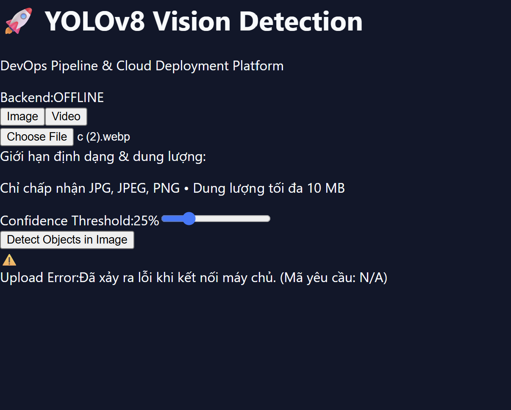
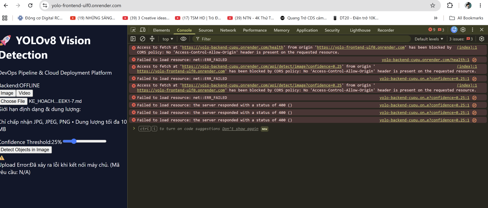

# Báo Cáo Bài Tập Xử Lý Sự Cố (Incident Exercise Report)

* **Mã sự cố (Incident ID):** INC-20261025-CORS-CORRELATION
* **Thời gian ghi nhận:** 25/10/2026
* **Hệ thống ảnh hưởng:** YOLO Web Platform (Backend API FastAPI trên Render & Frontend React trên Render)
* **Mức độ ảnh hưởng:** Medium – Chức năng nhận diện lõi không chết hoàn toàn, nhưng cơ chế thông báo lỗi bị gãy đổ: người dùng nhận thông báo lỗi giả (kết nối thất bại) và mã `request_id` bị mất (`N/A`), làm mất khả năng đối soát log giữa Client và Server.
* **Kỹ sư phụ trách:** Nguyễn Đức Anh

---

## 1. Triệu Chứng Sự Cố (Symptoms)

Khi người dùng thực hiện tải lên một tệp tin sai định dạng (ví dụ ảnh `.webp` hoặc tài liệu Markdown `.md` thay vì `.png`/`.png`):
1. **Giao diện người dùng (UI):** Thay vì hiển thị thông báo nghiệp vụ từ server ("Tệp tải lên không được hỗ trợ..."), màn hình lại quăng ra banner lỗi kết nối mặc định:
   > `Upload Error: Đã xảy ra lỗi khi kết nối máy chủ. (Mã yêu cầu: N/A)`
2. Mã định danh truy vết `request_id` bị rỗng (`N/A`), khiến kỹ sư trực vận hành không thể dùng mã này để tìm kiếm log tương ứng trên Render.



---

## 2. Nhật Ký Thu Thập Bằng Chứng (Evidence Collected)

Quá trình điều tra bằng chứng được thực hiện qua các tầng hệ thống theo đúng quy trình gỡ lỗi:

### A. Tầng Gateway & Hiện tượng Cold Start (Render Free Tier)
Trong những lần kiểm tra ban đầu khi container backend đang được khởi động lại hoặc kéo image mới:
* Trình duyệt gửi request tới `/health` và `/api/detect/image` nhưng nhận về mã phản hồi `502 Bad Gateway` từ proxy của Cloudflare/Render.
* Do trang lỗi 502 của proxy hạ tầng không chứa cấu hình CORS của ứng dụng, DevTools Console xuất hiện hàng loạt cảnh báo đỏ: `blocked by CORS policy: No 'Access-Control-Allow-Origin' header is present`.


### B. Tầng Backend API (Khi Server đã ONLINE)
Sau khi container backend khởi động hoàn tất (`GET /health` trả về `200 OK`):
* Người dùng tiếp tục gửi tệp sai định dạng. 
* Console ghi nhận: Backend đã nhận được request và **từ chối hợp lệ bằng mã `400 (Bad Request)`**.
* Tuy nhiên, giao diện vẫn tiếp tục báo lỗi `Upload Error: Đã xảy ra lỗi khi kết nối máy chủ. (Mã yêu cầu: N/A)`.




### C. Tầng Git & Đồng bộ Triển khai (Deployment Divergence)
Kiểm tra lịch sử Git trên GitHub phát hiện:
* Nhánh `main` trên GitHub đã được gộp PR #18 (`c35a88b`), nhưng máy trạm local chưa thực hiện `git pull` đồng bộ. 
* Các bản vá cục bộ bị phân nhánh so với remote, dẫn đến việc container Render chưa nạp đúng bản build mới nhất của mã nguồn.


---

## 3. Phân Tích Nguyên Nhân Gốc Rễ (Root Cause Analysis - RCA)

Sự cố "N/A Request ID" là hệ quả của **lỗi kép** giữa Backend và Frontend:

1. **Nguyên nhân tại Backend (FastAPI Exception Handler thiếu CORS Headers):**
   * Trong FastAPI, middleware CORS thông thường (`CORSMiddleware`) có thể không tự động bọc các phản hồi sinh ra từ `StarletteHTTPException` hoặc `HTTPException`.
   * Hàm bắt ngoại lệ tùy biến ban đầu chỉ trả về `JSONResponse` kèm header `X-Request-ID`, hoàn toàn thiếu các header:
     * `Access-Control-Allow-Origin`
     * `Access-Control-Allow-Methods`
     * `Access-Control-Allow-Headers`
   * Do đó, dù backend trả về body JSON chứa lỗi 400 và `request_id`, trình duyệt Chrome phát hiện thiếu header CORS nên **chặn đứng gói tin**, không cho mã JavaScript đọc nội dung phản hồi.

2. **Nguyên nhân tại Frontend (Sai lệch cơ chế xử lý lỗi giữa Fetch API và Axios):**
   * Frontend sử dụng hàm `fetch()` tiêu chuẩn của trình duyệt. Khi backend trả về mã `400`, `res.ok` mang giá trị `false`.
   * Đoạn mã Frontend cố gắng ném ngoại lệ `throw new Error(...)`, và tại khối `catch (err)`, mã nguồn lại truy xuất `err.response?.data?.detail` và `err.response?.data?.request_id`.
   * Đây là cấu trúc dữ liệu của thư viện **Axios**, không tồn tại trên đối tượng `Error` thuần của JavaScript.
   * Kết quả: Biến `err.response` bị `undefined`, kích hoạt giá trị dự phòng mặc định (fallback): `"Đã xảy ra lỗi khi kết nối máy chủ"` và `"N/A"`.

---

## 4. Các Bước Khắc Phục (Resolution & Fix)

### Bước 1: Ép buộc đính kèm Header CORS tại Backend Exception Handler
Tại `backend/app/main.py`, chuẩn hóa hàm xử lý `StarletteHTTPException` để luôn gửi trả toàn bộ header CORS:

```python
@app.exception_handler(StarletteHTTPException)
async def custom_http_exception_handler(request: Request, exc: StarletteHTTPException):
    request_id = getattr(request.state, "request_id", "req-unknown")
    headers = {
        "X-Request-ID": request_id,
        "Access-Control-Allow-Origin": "*",
        "Access-Control-Allow-Methods": "*",
        "Access-Control-Allow-Headers": "*",
        "Access-Control-Expose-Headers": "X-Request-ID",
    }
    return JSONResponse(
        status_code=exc.status_code,
        content={"detail": exc.detail, "request_id": request_id},
        headers=headers,
    )
```

### Bước 2: Chuẩn hóa bóc tách dữ liệu lỗi tại Frontend

Tại `frontend/src/App.jsx`, xử lý phản hồi lỗi trực tiếp từ đối tượng `Response` của `fetch()` thay vì dựa vào khối `catch`:

JavaScript
```
if (!res.ok) {
  let errDetail = `Lỗi ${res.status}: Xử lý thất bại.`;
  let reqId = res.headers.get('X-Request-ID') || "N/A";

  try {
    const errData = await res.json();
    if (errData && errData.detail) errDetail = errData.detail;
    if (errData && errData.request_id) reqId = errData.request_id;
  } catch (_) {
    // Phản hồi không phải định dạng JSON
  }

  setError(`${errDetail} (Mã yêu cầu: ${reqId})`);
  return;
}
```

### Bước 3: Đồng bộ Git và kích hoạt Render Deployment

- Thực hiện giải quyết phân nhánh Git bằng `git pull --rebase origin main`.
- Đẩy mã nguồn thống nhất lên nhánh `main` để Render tự động build lại cả Frontend và Backend service.

## 5. Nghiệm Thu & Kiểm Thử Sau Bản Vá (Verification)

Sau khi bản vá được kích hoạt trên môi trường Cloud:

1. **Kiểm tra Response Headers:** Gói tin trả lời mã `400 Bad Request` đã hiển thị đầy đủ các header cấp phép CORS cùng con dấu `X-Request-ID`:
   - `Access-Control-Allow-Origin: https://yolo-frontend-ulf0.onrender.com`
   - `Access-Control-Expose-Headers: ..., X-Request-ID`

2) **Kiểm tra Response Payload & UI:**
   - Trình duyệt đọc được chuỗi JSON:

     `{"detail": "Tệp tải lên bị hỏng hoặc định dạng 'image/webp' không được hỗ trợ...", "request_id": "req-d32f74bd"}`
   - Giao diện UI hiển thị chính xác thông báo chi tiết kèm mã yêu cầu thực tế:

     `Upload Error: Tệp tải lên bị hỏng hoặc định dạng 'image/webp' không được hỗ trợ... (Mã yêu cầu: req-d32f74bd)`.
3) **Đối soát nhật ký (Correlation Match):** Tìm kiếm mã `req-d32f74bd` trong hệ thống log của Render, log hiển thị chính xác dòng cảnh báo tương ứng với độ trễ xử lý 10.02ms. Chu trình giám sát và gỡ lỗi khép kín thành công.

## 6. Bài Học Kinh Nghiệm & Phòng Ngừa (Prevention)

- **Kiểm thử tự động cho Exception:** Viết thêm test case trong `pytest` để kiểm tra rằng mọi phản hồi lỗi (400, 404, 422, 500) đều bắt buộc phải có header CORS và `X-Request-ID`.
- **Thống nhất chuẩn HTTP Client:** Tuyệt đối không dùng lẫn lộn tư duy cú pháp giữa Fetch API và Axios trong cùng một dự án.
- **Quy trình Git Flow nghiêm ngặt:** Luôn chạy `git pull` cập nhật nhánh `main` trước khi tạo commit mới để tránh xung đột hoặc lệch pha triển khai trên nền tảng Cloud.
