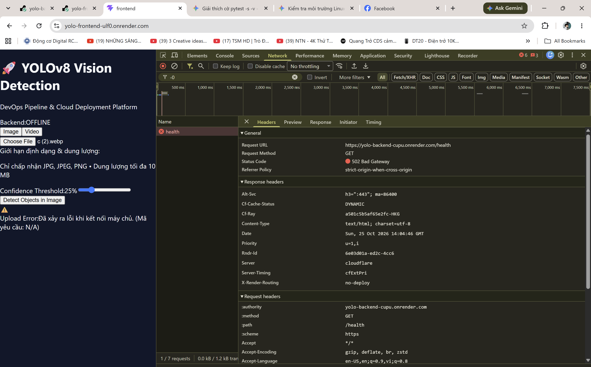
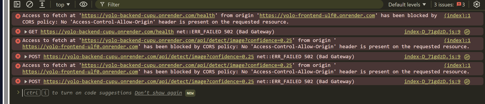
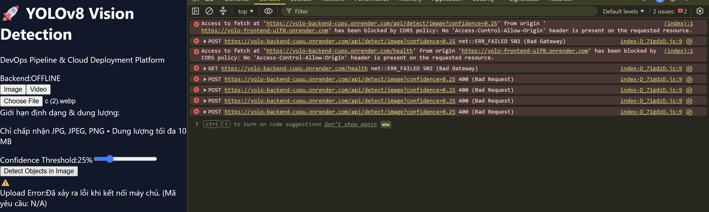

# Báo Cáo Bài Tập Xử Lý Sự Cố (Incident Exercise Report)

* **Mã sự cố (Incident ID):** INC-20261025-CORS-CORRELATION & INC-20261026-EVENTLOOP-502
* **Thời gian xử lý:** 25/10/2026 – 26/10/2026
* **Hệ thống ảnh hưởng:** YOLO Web Platform (Backend API FastAPI & Frontend React trên Render)
* **Mức độ ảnh hưởng:** High – Sự cố diễn tiến qua 2 giai đoạn: Sau khi khắc phục xong lỗi mất mã định danh truy vết (`request_id: N/A`), hệ thống phát sinh lỗi hồi quy (regression) làm sập tiến trình (`502 Bad Gateway` / Container Restart) khi thực hiện suy luận ảnh thực tế.
* **Kỹ sư phụ trách:** Nguyễn Đức Anh

---

## 1. Dòng Thời Gian & Triệu Chứng Diễn Tiến (Timeline & Symptoms)

Sự cố diễn ra theo chuỗi logic kỹ thuật "Khắc phục lỗi trước làm bộc lộ lỗi sau":

### Giai đoạn 1 (Ngày 25/10/2026): Lỗi đứt gãy luồng thông báo lỗi khi tải tệp sai định dạng
* **Triệu chứng:** Khi người dùng gửi file sai định dạng (ví dụ `.webp`, `.md`), thay vì hiển thị thông báo nghiệp vụ chi tiết của backend, giao diện luôn rơi vào khối lỗi kết nối mặc định:
   > `Upload Error: Đã xảy ra lỗi khi kết nối máy chủ. (Mã yêu cầu: N/A)`
* Mã `request_id` bị rỗng (`N/A`), làm mất hoàn toàn khả năng đối soát log giữa Client và Server.


### Giai đoạn 2 (Ngày 26/10/2026): Phát sinh lỗi hồi quy 502 khi suy luận ảnh hợp lệ
* **Bối cảnh:** Sau khi bổ sung middleware ghi log và cấu hình lại `http_exception_handler`, việc tải tệp lỗi đã hiển thị đúng mã yêu cầu.
* **Triệu chứng mới phát sinh:** Khi gửi một bức ảnh hợp lệ (`.jpg`, `.png`) để nhận diện, request bị treo rất lâu, sau đó trình duyệt văng lỗi **`502 Bad Gateway`** kèm cảnh báo `blocked by CORS policy`.
* **Phía máy chủ Render:** Container bị hủy đột ngột và tự khởi động lại (`Started server process [1]`, nạp lại mô hình `yolov8n.pt`), khiến hệ thống mất tính sẵn sàng.

---

## 2. Nhật Ký Thu Thập Bằng Chứng (Evidence Collected)

Quá trình điều tra bằng chứng được thực hiện qua các tầng hệ thống theo đúng quy trình gỡ lỗi:

### A. Tầng Gateway, Cold Start & Lỗi 502 Ban Đầu (25/10)
Trong những lần kiểm tra ban đầu khi container backend đang được khởi động lại hoặc kéo image mới:
* Trình duyệt gửi request tới `/health` và `/api/detect/image` nhưng nhận về mã phản hồi `502 Bad Gateway` từ proxy của Cloudflare/Render.
* Do trang lỗi 502 của proxy hạ tầng không chứa cấu hình CORS của ứng dụng, DevTools Console xuất hiện hàng loạt cảnh báo đỏ: `blocked by CORS policy: No 'Access-Control-Allow-Origin' header is present`.




### B. Tầng Backend API (Khi Server đã ONLINE - 25/10)
Sau khi container backend khởi động hoàn tất (`GET /health` trả về `200 OK`):
* Người dùng tiếp tục gửi tệp sai định dạng.
* Console ghi nhận: Backend đã nhận được request và **từ chối hợp lệ bằng mã `400 (Bad Request)`**.
* Tuy nhiên, giao diện vẫn tiếp tục báo lỗi `Upload Error: Đã xảy ra lỗi khi kết nối máy chủ. (Mã yêu cầu: N/A)`.




### C. Tầng Git & Đồng bộ Triển khai (25/10)
Kiểm tra lịch sử Git trên GitHub phát hiện:
* Nhánh `main` trên GitHub đã được gộp PR #18 (`c35a88b`), nhưng máy trạm local chưa thực hiện `git pull` đồng bộ.
* Các bản vá cục bộ bị phân nhánh so với remote, dẫn đến việc container Render chưa nạp đúng bản build mới nhất của mã nguồn.


### D. Tầng Giả Lập Cục Bộ Cách Ly Tài Nguyên (26/10)
Để điều tra lỗi sập tiến trình khi gửi ảnh đúng sau bản vá ngày 25/10:
* Khởi chạy container trên máy local với giới hạn cứng 512MB RAM tương đồng Render:
  `podman run --rm -it -p 8000:8000 -m 512m localhost/yolo-backend:test`
* Gửi file ảnh hợp lệ 31 KB qua `curl`: Backend xử lý hoàn tất trong **913 ms**, trả về mã `200 OK` kèm danh sách detection và chuỗi base64.
* **Kết luận bằng chứng:** Mã nguồn không bị lỗi cú pháp, không bị tràn RAM (OOM). Vấn đề nằm ở sự khác biệt năng lực CPU và cơ chế thăm dò sức khỏe (Health Check) giữa môi trường local và cloud Render.

---

## 3. Phân Tích Nguyên Nhân Gốc Rễ (Root Cause Analysis - RCA)

Sự cố diễn ra theo hai mắt xích nguyên nhân nối tiếp:

### 1. Nguyên nhân gốc rễ của Lỗi Giai đoạn 1 (Lỗi N/A Request ID):
* **Backend:** Middleware CORS thông thường (`CORSMiddleware`) của FastAPI có thể không tự động bọc các phản hồi sinh ra từ `StarletteHTTPException` hoặc `HTTPException`. Hàm bắt ngoại lệ tùy biến ban đầu chỉ trả về `JSONResponse` trơn, thiếu các header `Access-Control-Allow-Origin`. Do đó, trình duyệt chặn không cho JavaScript đọc nội dung JSON lỗi 400 và `request_id`.
* **Frontend:** Đoạn mã sử dụng hàm `fetch()` tiêu chuẩn của trình duyệt nhưng lại bắt lỗi theo cấu trúc `err.response?.data` của thư viện **Axios**. Khi gặp lỗi, `err.response` bị `undefined`, kích hoạt giá trị dự phòng mặc định (fallback): `"Đã xảy ra lỗi khi kết nối máy chủ"` và `"N/A"`.

### 2. Nguyên nhân gốc rễ của Lỗi Giai đoạn 2 (Lỗi 502 khi suy luận ảnh):
* **Nghẽn Event Loop do hàm bất đồng bộ (`async def`):** Hàm `detect_image` được khai báo là `async def`. Trong FastAPI, hàm `async` chạy trực tiếp trên Event Loop chính của tiến trình Python.
* **Tác vụ CPU-bound:** Lệnh `model.predict()` là tác vụ tính toán nặng, ngốn trọn CPU. Trên máy tính local, CPU mạnh xử lý xong chỉ mất ~0.9s nên không ảnh hưởng. Tuy nhiên trên Render Free Tier (vCPU chia sẻ rất yếu), tác vụ này chiếm dụng tài nguyên kéo dài.
* **Đứt gãy cơ chế giám sát (Health Check Timeout):** Trong suốt thời gian YOLO chạy, Event Loop chính bị phong tỏa hoàn toàn (blocked), không thể phản hồi các tín hiệu ping thăm dò định kỳ (`/health` hoặc `/ready`) từ hệ thống giám sát của Render.
* **Hậu quả:** Render đánh giá container bị treo (Deadlock/Unresponsive) nên gửi tín hiệu `SIGKILL` tiêu diệt tiến trình, làm kết nối với trình duyệt bị đứt đột ngột và reverse-proxy trả về `502 Bad Gateway`.

---

## 4. Các Bước Khắc Phục (Resolution & Fix)

### Bước 1: Khắc phục lỗi Giai đoạn 1 (CORS & Bóc tách Request ID)
1. Ép header CORS tại `http_exception_handler` trong `backend/main.py` để trình duyệt luôn đọc được mã lỗi:

```python
@app.exception_handler(HTTPException)
async def http_exception_handler(request: Request, exc: HTTPException):
    req_id = getattr(request.state, "request_id", "req-unknown")
    headers = {
        "X-Request-ID": req_id,
        "Access-Control-Allow-Origin": "*",
        "Access-Control-Allow-Methods": "*",
        "Access-Control-Allow-Headers": "*",
        "Access-Control-Expose-Headers": "X-Request-ID",
    }
    return JSONResponse(
        status_code=exc.status_code,
        content={"detail": exc.detail, "request_id": req_id},
        headers=headers,
    )
```

2. Chuẩn hóa Frontend `frontend/src/App.jsx` đọc lỗi trực tiếp từ đối tượng `Response` của `fetch()`:

JavaScript

```javascript
if (!res.ok) {
  let errDetail = `Lỗi ${res.status}: Xử lý thất bại.`;
  let reqId = res.headers.get('X-Request-ID') || "N/A";

  try {
    const errData = await res.json();
    if (errData && errData.detail) errDetail = errData.detail;
    if (errData && errData.request_id) reqId = errData.request_id;
  } catch (_) {
    // Phản hồi không phải định dạng JSON
  }

  setError(`${errDetail} (Mã yêu cầu: ${reqId})`);
  return;
}
```

### Bước 2: Khắc phục lỗi Giai đoạn 2 (Bỏ chặn Event Loop & Xử lý ngoại lệ toàn cục)

1. **Chuyển `detect_image` sang `def` đồng bộ:** Chuyển từ `async def` sang `def` thường để FastAPI tự động đẩy việc chạy YOLO sang Threadpool riêng, giải phóng Event Loop chính để phản hồi tức thì các lượt ping `/ready` và `/health`:

Python

```python
@app.post("/api/detect/image")
def detect_image(
    request: Request,
    file: UploadFile = File(...),
    conf_threshold: float = Query(default=0.25, ge=0.05, le=1.0),
    confidence: Optional[float] = Query(default=None, ge=0.05, le=1.0)
):
    req_id = getattr(request.state, "request_id", "unknown")
    threshold = confidence if confidence is not None else conf_threshold

    # Đọc dữ liệu nhị phân đồng bộ
    image_bytes = file.file.read()
    file_size_mb = round(len(image_bytes) / (1024 * 1024), 2)
    ...

    # Chuẩn hóa dải màu RGB và nạp ảnh an toàn
    image = Image.open(io.BytesIO(image_bytes)).convert("RGB")

    # Thực hiện suy luận mô hình
    results = model.predict(source=image, conf=threshold, imgsz=320, device="cpu", verbose=False)
    ...
```

2. **Bổ sung `global_exception_handler`:** Bắt toàn bộ lỗi runtime chưa lường trước, luôn trả kèm header CORS để không bị rơi vào trang lỗi 502 trắng trơn của Render:

Python

```python
@app.exception_handler(Exception)
async def global_exception_handler(request: Request, exc: Exception):
    req_id = getattr(request.state, "request_id", "req-unknown")
    logger.error(f"UNHANDLED_EXCEPTION [{req_id}]: {str(exc)}", exc_info=True)
    return JSONResponse(
        status_code=status.HTTP_500_INTERNAL_SERVER_ERROR,
        content={"detail": f"Lỗi xử lý nội bộ: {str(exc)}", "request_id": req_id},
        headers={
            "Access-Control-Allow-Origin": "*",
            "Access-Control-Allow-Methods": "*",
            "Access-Control-Allow-Headers": "*",
            "X-Request-ID": req_id
        }
    )
```

### Bước 3: Đồng bộ Git và kích hoạt Render Deployment

- Thực hiện giải quyết phân nhánh Git bằng `git pull --rebase origin main`.
- Đẩy mã nguồn thống nhất qua nhánh fix chuyên biệt và gộp vào `main` để Render tự động build lại cả Frontend và Backend service.

## 5. Nghiệm Thu & Kiểm Thử Sau Bản Vá (Verification)

Sau khi bản vá được kích hoạt hoàn chỉnh trên môi trường Cloud Render:

### Nghiệm thu 1: Kiểm thử tệp sai định dạng (Khắc phục triệt để Giai đoạn 1)

- Tải lên tệp ảnh `.webp`: Máy chủ từ chối với mã `400 Bad Request`.
- Giao diện UI hiển thị chính xác thông báo nghiệp vụ kèm mã tương quan thực tế:

  `Upload Error: Tệp tải lên bị hỏng hoặc định dạng 'image/webp' không được hỗ trợ. Chỉ chấp nhận JPG, JPEG, PNG. (Mã yêu cầu: req-e06c4eb1)`


### Nghiệm thu 2: Kiểm thử suy luận ảnh hợp lệ (Khắc phục triệt để Giai đoạn 2)

- Người dùng tải lên ảnh chụp thực tế 2 người.
- Tab Network ghi nhận endpoint `/api/detect/image` phản hồi mã **`200 OK`** thành công.
- Giao diện hiển thị ảnh kết quả `Annotated (YOLOv8)` có đầy đủ các hộp nhận diện chính xác: `person 0.94` và `person 0.89`.
- Trạng thái duy trì ổn định `Backend: ONLINE`, không còn hiện tượng container bị restart hay văng lỗi 502.


## 6. Bài Học Kinh Nghiệm & Phòng Ngừa (Prevention)

- **Phân biệt `def` và `async def` trong FastAPI:** Không bao giờ dùng `async def` cho các tác vụ nặng ngốn CPU (CPU-bound) như Machine Learning inference (YOLO, PyTorch) hoặc xử lý ảnh/video. Phải dùng `def` thường để FastAPI đưa vào Threadpool, tránh làm tê liệt Event Loop chính.
- **Cảnh giác với lỗi hồi quy (Regression Bug):** Khi thêm middleware ghi log hoặc exception handler mới, luôn kiểm thử cả 2 chiều: luồng trả về lỗi (4xx) và luồng xử lý thành công (200 OK với tải nặng) để đảm bảo không làm gãy luồng phản hồi.
- **Parity Testing (Đồng nhất môi trường):** Sử dụng các cờ giới hạn tài nguyên (`-m 512m`) khi chạy container ở máy local để phát hiện sớm các rủi ro nghẽn luồng hoặc chạm trần bộ nhớ trước khi triển khai lên Cloud.
- **Kiểm thử tự động cho Exception:** Viết thêm test case trong `pytest` để kiểm tra rằng mọi phản hồi lỗi (400, 404, 422, 500) đều bắt buộc phải có header CORS và `X-Request-ID`.
- **Thống nhất chuẩn HTTP Client:** Tuyệt đối không dùng lẫn lộn tư duy cú pháp giữa Fetch API và Axios trong cùng một dự án.
- **Quy trình Git Flow nghiêm ngặt:** Luôn chạy `git pull` cập nhật nhánh `main` trước khi tạo commit mới để tránh xung đột hoặc lệch pha triển khai trên nền tảng Cloud.

